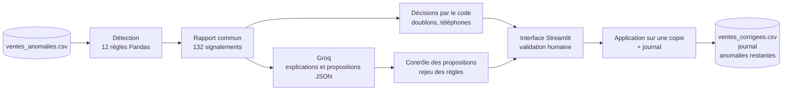

# AI Data Cleaning Agent

Un agent qui **inspecte** des données commerciales, **détecte** les anomalies par des règles métier, **fait expliquer et proposer** des corrections par un LLM, puis laisse un **humain valider** avant toute modification.


> Projet pédagogique et professionnel. Cas d'usage : une petite entreprise de distribution au Cameroun, montants en francs CFA (XAF). Toutes les données sont synthétiques.

---

## Sommaire

- [Principes de conception](#principes-de-conception)
- [Architecture](#architecture)
- [Règles de détection](#règles-de-détection)
- [Rôle du LLM](#rôle-du-llm)
- [Interface de validation](#interface-de-validation)
- [Résultats](#résultats)
- [Installation](#installation)
- [Utilisation](#utilisation)
- [Structure du projet](#structure-du-projet)
- [Limites connues](#limites-connues)
- [Feuille de route](#feuille-de-route)

---

## Principes de conception

| Principe | Application dans le projet |
|---|---|
| **Le code détecte, le LLM interprète** | Les anomalies sont trouvées par des règles Pandas déterministes. Le LLM ne sert qu'à expliquer et proposer. |
| **Un LLM propose, la règle vérifie** | Chaque correction proposée est rejouée contre les règles avant d'être acceptée. |
| **Le code décide quand c'est mécanique** | Les doublons exacts et les formats de téléphone sont traités sans LLM. |
| **L'humain valide** | Aucune donnée n'est modifiée sans une décision explicite. Les fichiers d'origine ne sont jamais touchés. |
| **Tout est traçable** | Chaque modification laisse une ligne dans un journal : ancienne valeur, nouvelle valeur, résultat, motif. |
| **Les traitements sont reprenables** | Les décisions du LLM sont enregistrées au fur et à mesure : une coupure ne fait rien perdre. |

---

## Architecture



### Stack technique

| Composant | Technologie | Rôle |
|---|---|---|
| Traitement des données | **Python, Pandas** | Détection des anomalies, application des corrections |
| LLM | **Groq** (modèle configurable) | Explications et propositions de correction structurées en JSON |
| Interface | **Streamlit** | Revue des signalements, décisions, export |
| Configuration | **python-dotenv** | Clé d'API et modèle hors du code |

---

## Règles de détection

Douze règles, regroupées dans une liste de détecteurs. Chaque détecteur renvoie le même schéma (`ligne_csv`, `commande_id`, `regle`, `colonne`, `valeur_observee`, `explication`), ce qui permet de les assembler dans un rapport unique.

| Règle | Anomalie détectée |
|---|---|
| R-01 | Montant payé supérieur au montant total |
| R-02 | Quantité nulle ou négative |
| R-03 | Prix unitaire nul ou négatif |
| R-04 | Date de livraison antérieure à la date de commande |
| R-05 | Identifiant de commande répété avec un contenu différent |
| R-06 | Lignes entièrement identiques (doublons exacts) |
| R-07 | Montant total différent de quantité × prix unitaire |
| R-08 | Valeur manquante dans une colonne obligatoire |
| R-09 | Date illisible, impossible ou hors format `YYYY-MM-DD` |
| R-10 | E-mail ou téléphone mal formé (`+237 6XX XX XX XX`) |
| R-11 | Espaces superflus, casse incohérente, valeur hors liste autorisée |
| R-12 | Incohérences métier : statuts, produit et catégorie, client et ville, prix et quantités aberrants |

Le contexte métier est respecté : l'absence d'e-mail (champ facultatif), les paiements partiels ou les clients qui reviennent ne sont **pas** des anomalies. Le dictionnaire complet est dans [`dictionnaire_et_regles.md`](dictionnaire_et_regles.md).

---

## Rôle du LLM

Le LLM reçoit **une ligne du fichier avec tous ses signalements** et répond avec un objet JSON imposé :

```json
{
  "resultats": [
    {
      "id_signalement": "SIG-008",
      "action": "corriger",
      "correction_proposee": "14",
      "justification": "Quantité négative : 231 000 ÷ 16 500 = 14."
    }
  ]
}
```

Les actions possibles sont `corriger`, `supprimer` et `verifier_manuellement`. Il lui est interdit d'inventer une valeur absente.

### Trois filets de sécurité

1. **Validation du contrat** : forme du JSON, champs présents, action autorisée, cohérence entre champs. Un signalement sans réponse valable est renvoyé à l'humain.
2. **Contrôle des propositions** : une correction n'est retenue que si elle change la valeur, appartient à la liste autorisée, respecte le format, et est **confirmée par les autres colonnes** (par exemple une quantité doit valoir total ÷ prix). Sinon, elle devient `verifier_manuellement`.
3. **Décisions déterministes** : les doublons exacts (la copie est supprimée, l'original conservé) et les téléphones (chiffres conservés, format reconstruit) ne passent jamais par le LLM.

---

## Interface de validation

L'application Streamlit organise le travail par groupes d'actions :

| Onglet | Contenu | Mode de travail |
|---|---|---|
| **À corriger** | Corrections proposées | Un par un, ou **accepter le lot** (annulable) |
| **À supprimer** | Copies exactes | Un par un, ou **accepter le lot** (annulable) |
| **À vérifier** | Cas qu'un humain doit trancher | **File d'attente** : le suivant s'affiche après chaque décision |
| **Appliquer et exporter** | Application, journal, téléchargements | Résultat avant et après |

Pour chaque signalement, l'interface montre la ligne complète du CSV (avec son numéro dans Excel), la règle enfreinte, la proposition du modèle et sa justification. L'humain peut accepter, refuser, ou **saisir sa propre valeur**, contrôlée par les mêmes règles que le moteur.

**Exports :** fichier corrigé, journal des modifications, rapport avec les décisions, et **anomalies restantes** à remettre à l'équipe métier.

---

## Résultats

Mesurés sur le jeu synthétique de 326 lignes, en acceptant toutes les corrections et suppressions proposées.

| Étape | Résultat |
|---|---|
| Lignes du fichier | 326, dont 6 copies exactes supprimées, soit 320 lignes corrigées |
| Signalements détectés | **132** |
| Décisions du modèle | 45 corrections, 6 suppressions, 6 conservations, 75 cas renvoyés à l'humain |
| Corrections appliquées | 49 (le total inclut les corrections par le code) |
| Signalements après correction | **62**, tous à traiter par un humain |

| Règle | Avant | Après |
|---|---:|---:|
| R-01 Paiement excessif | 8 | 3 |
| R-02 Quantité invalide | 3 | 1 |
| R-03 Prix invalide | 4 | 2 |
| R-04 Livraison avant commande | 4 | 4 |
| R-05 Identifiant répété | 8 | 8 |
| R-06 Doublons exacts | 12 | 0 |
| R-07 Total incohérent | 12 | 2 |
| R-08 Valeurs manquantes | 18 | 16 |
| R-09 Dates invalides | 6 | 3 |
| R-10 Formats e-mail et téléphone | 13 | 2 |
| R-11 Problèmes de texte | 19 | 1 |
| R-12 Incohérences métier | 25 | 20 |
| **Total** | **132** | **62** |

Aucune règle n'augmente après correction : aucune correction n'a créé de nouvelle anomalie. Les anomalies restantes sont celles qui exigent une décision humaine, comme une date impossible ou un identifiant en double avec des contenus différents.

---

## Installation

**Prérequis :** Python 3.10 ou plus, et une clé d'API [Groq](https://console.groq.com).

```bash
git clone https://github.com/<ton-compte>/AI-Data-Cleaning-Agent.git
cd AI-Data-Cleaning-Agent

python -m venv .venv
# Windows : .venv\Scripts\activate    |    macOS/Linux : source .venv/bin/activate

pip install -r requirements.txt
```

**Configuration** : copie `.env.example` en `.env` et renseigne :

```env
GROQ_API_KEY=ta_cle_api
GROQ_MODEL=openai/gpt-oss-120b
```

> Les noms de modèles évoluent et les anciens sont retirés. Vérifie la liste dans la console Groq et ajuste `GROQ_MODEL` si besoin. Ne publie jamais ton `.env`.

---

## Utilisation

Le parcours complet se fait en trois commandes :

```bash
# 1. Détection : génère rapport_anomalies.csv
python rapport.py

# 2. Explications et propositions par le LLM : génère rapport_enrichi.csv
#    (reprend là où il s'est arrêté en cas de coupure)
python traitement.py

# 3. Interface de validation humaine
streamlit run app.py
```

**Test de bout en bout** (sans interface) : accepte toutes les propositions, applique, puis relance les détecteurs sur le fichier corrigé.

```bash
python test_bout_en_bout.py
```

---

## Structure du projet

```
AI-Data-Cleaning-Agent/
├── ventes_anomalies.csv         # Jeu de données synthétique (326 lignes, 17 colonnes)
├── dictionnaire_et_regles.md    # Dictionnaire des colonnes et règles métier
├── regles.py                    # 12 détecteurs et liste des règles
├── rapport.py                   # Assemblage du rapport commun
├── llm.py                       # Contrat avec le LLM, messages, validation des réponses
├── traitement.py                # Traitement reprenable, décisions du code, contrôle des propositions
├── appliquer.py                 # Application des décisions validées et journal
├── app.py                       # Interface Streamlit
├── exploration.py               # Exploration initiale des données
├── test_bout_en_bout.py         # Test avant/après sur les détecteurs
├── requirements.txt
└── .env.example
```

---

## Limites connues

- **Les règles ne détectent pas tout.** Un détecteur ne voit que ce qu'on lui a appris à chercher : par exemple, l'incohérence entre un produit et sa catégorie ne se repère que si le produit a assez de lignes pour faire ressortir une majorité.
- **Le motif d'e-mail est volontairement simple** : il laisse passer certaines adresses invalides, comme `.nom@gmail.com`.
- **Dates :** seul le format ISO `YYYY-MM-DD` est accepté comme valide, les autres sont signalés.
- **Le LLM peut se tromper**, notamment en arithmétique. C'est pour cela que ses propositions sont contrôlées et validées par un humain.
- **Quotas de l'API :** le traitement est séquentiel, avec pauses et reprise automatique.
- **Session Streamlit :** les décisions sont perdues si la page est rafraîchie. Le rapport avec les décisions est téléchargeable à tout moment.
- **Numéros de ligne :** `ligne_csv` se rapporte au fichier d'origine, pas au fichier corrigé.

---

## Feuille de route

- [ ] Orchestration du flux avec **LangGraph** : détecter, expliquer, pause de validation humaine, appliquer, contrôle final
- [ ] Recharger un rapport avec décisions dans l'interface
- [ ] Ajouter les références (formats, listes autorisées) directement dans le prompt
- [ ] Tests unitaires par règle
- [ ] Mesure formelle de la détection contre une clé de correction

---

## Auteur

Kengne Ronny · [GitHub](https://github.com/Drronnyk) · [LinkedIn](https://www.linkedin.com/in/ronny-Kengne)

## Licence

MIT
